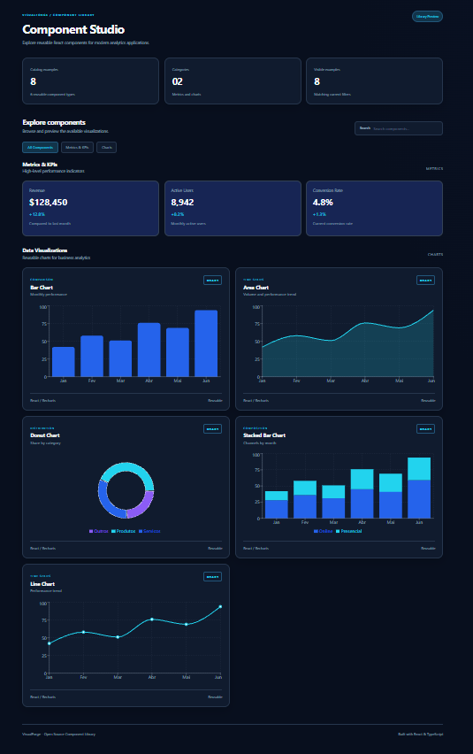
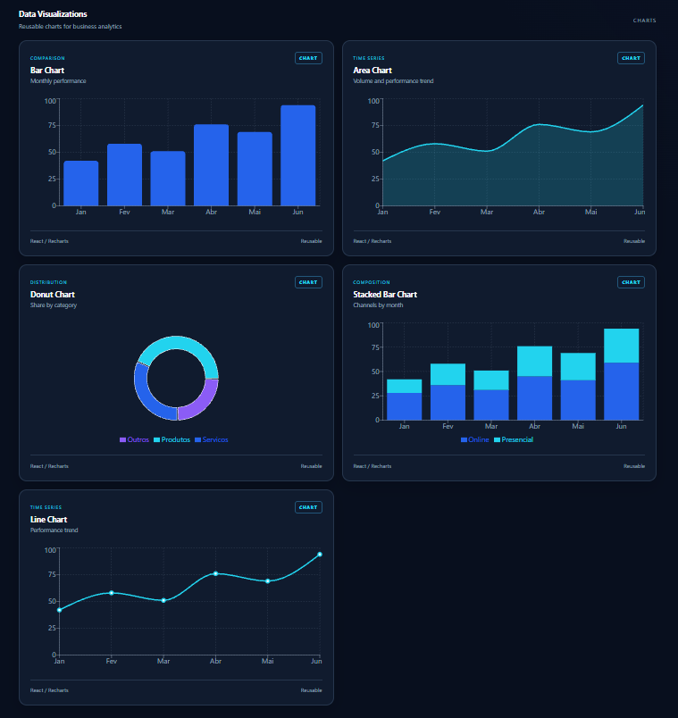
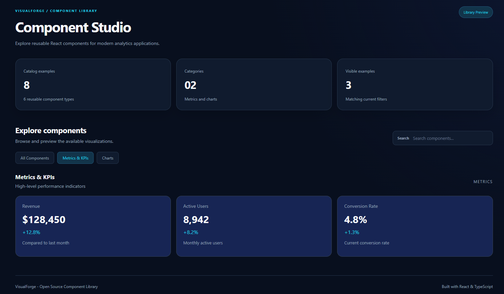

# VisualForge

**Language / Idioma:** English | [Português (Brasil)](README.pt-BR.md)

**Build. Visualize. Reuse.**

VisualForge is an open-source React component library for dashboards and data visualization, built with TypeScript and Recharts.

> **Alpha release:** `v0.1.0-alpha.0`. The library is under active development and is **not yet published to npm**. The examples below run inside this repository's npm workspace.

## Visual Showcase

Explore VisualForge Studio, the interactive gallery showcasing reusable React components for modern dashboards.

### Studio Overview



### Charts Showcase

Explore bar, line, area, donut, and stacked bar charts.



### Metrics & KPIs

Build executive dashboards with reusable KPI cards.



## Components

| Component | Purpose |
| --- | --- |
| `KpiCard` | Present key performance indicators |
| `BarChart` | Compare values across categories |
| `LineChart` | Display trends |
| `AreaChart` | Show trends and magnitude |
| `DonutChart` | Display composition and proportions |
| `StackedBarChart` | Compare multiple series per category |

Explore all six component types in **VisualForge Studio**, the interactive gallery in `apps/gallery`.

## Requirements

- Node.js 24
- npm 11

## Run locally

```bash
git clone https://github.com/afonsooliveiradev/VisualForge.git
cd VisualForge
npm ci
npm run dev
```

Open the local URL printed by Vite.

## Example (inside the workspace)

```tsx
import { KpiCard, BarChart, DonutChart, StackedBarChart } from '@visualforge/react';

const monthly = [
  { name: 'Jan', value: 42 },
  { name: 'Feb', value: 58 },
  { name: 'Mar', value: 76 },
];

const segments = [
  { name: 'Products', value: 65 },
  { name: 'Services', value: 35 },
];

const channels = [
  { name: 'Jan', online: 30, offline: 12 },
  { name: 'Feb', online: 42, offline: 18 },
];

export function Dashboard() {
  return (
    <div>
      <KpiCard title="Revenue" value="$128,450" change="+12.8%" />
      <BarChart data={monthly} />
      <DonutChart data={segments} />
      <StackedBarChart
        data={channels}
        series={[
          { dataKey: 'online', name: 'Online' },
          { dataKey: 'offline', name: 'Offline' },
        ]}
      />
    </div>
  );
}
```

## Repository structure

```text
apps/gallery/      VisualForge Studio
packages/react/    Reusable React components
docs/              Architecture and technical documentation
examples/          Integration examples
```

## Quality checks

```bash
npm run typecheck
npm test
npm run build
npm audit
```

## Current limitations

- `@visualforge/react` is currently a private workspace package and cannot be installed from the npm registry.
- Package exports currently reference TypeScript source files; a distributable JavaScript build and declaration files are not yet configured.
- Component APIs, accessibility, and test coverage are evolving during the alpha phase.

## Contributing

Issues, feedback, and pull requests are welcome. See [CONTRIBUTING.md](CONTRIBUTING.md).

## License

[MIT](LICENSE).

## Documentation and community

- [Component API (English)](docs/components.md) / [API (Português)](docs/pt-BR/components.md)
- [Getting started (Português)](docs/pt-BR/getting-started.md)
- [Code of Conduct](CODE_OF_CONDUCT.md) | [Security Policy](SECURITY.md)
